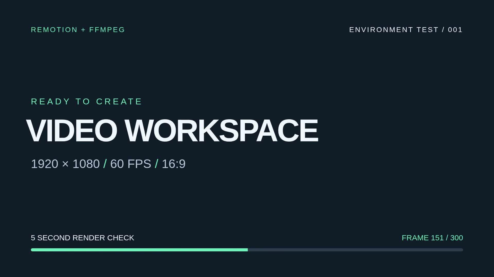

# AI 视频制作环境

这是用于 AI 辅助视频制作的 Remotion + FFmpeg 项目。环境及 5 秒测试已验证，已完成按用户反馈修订的无配音新媒体运营介绍短片。

## 当前第二版：完整成片

已按用户最新要求完成完整无配音成片，7800帧与全长音频解码通过：2分10秒、40段已确认原文；恢复中心主体与底部宋体正文，放慢动画，纯黑与深色浅波点背景按段落交替。音乐使用用户上传BGM，配原创材质音效。

[完整成片与制作说明](production/new-media-v2/final-production.md) · [下载完整MP4](https://github.com/zb792686831-ux/vibe/raw/refs/heads/main/output/new-media-v2-final.mp4) · [媒体验证](output/new-media-v2-final-validation.json) · [当前状态](production/new-media-v2/approval-state.json)

`npm run video:build` 已切换为当前第二版流程；在保留用户音乐的环境中，先用 `npm run video:prepare` 生成本地全长混音。旧带配音流程保留为 `npm run video:legacy:build`。之前的R1／R2候选见制作目录，属于历史样稿。

## 历史第一版（带配音）

**历史音画样片，该版本缺参考BGM；当前第二版已使用用户上传音乐。**全片 2 分 50.8 秒、17 场、49 句普通话旁白，使用原创矢量动画和原创合成音效。用户指定的抖音参考音乐尚未取得，没有擅自换曲，也没有把缺音乐的版本标为最终版。

[下载音画样片 MP4](https://github.com/zb792686831-ux/vibe/raw/refs/heads/main/output/new-media-intro-preview.mp4) · [完整脚本](production/new-media/script.md) · [制作与待办](production/new-media/README.md)


此历史版本使用 `npm run video:legacy:build` 重建；逐句配音时间轴准备使用 `npm run video:legacy:prepare`。详细依赖、音源状态及配音复核见制作目录。

默认规格：**16:9、1920×1080、60fps**。测试组合名为 `SetupTest`，时长 5 秒，共 300 帧；最终视频使用 H.264 / yuv420p、BT.709 色彩空间，附带 AAC 测试音轨。

## 查看测试视频

[下载 5 秒测试 MP4](https://github.com/zb792686831-ux/vibe/raw/refs/heads/main/output/test-5s.mp4) · [视频文件页面](output/test-5s.mp4) · [验证报告](output/validation.json)



这个测试视频及截图随项目提交，便于从 GitHub 查看和下载。其他导出文件默认保留在本地，不纳入 Git。

## 目录

| 路径 | 用途 |
| --- | --- |
| `public/videos/` | 视频素材 |
| `public/audio/` | 配音和背景音乐 |
| `public/images/` | 图片素材 |
| `output/` | 最终视频、测试中间文件和验证报告 |
| `src/` | Remotion 组合与动画代码 |
| `.agents/skills/remotion-best-practices/` | 供 Codex 使用的官方 Remotion Skill |

在组合中使用 `staticFile('videos/素材文件名.mp4')` 等路径引用 `public/` 下的素材，不把 `public/` 写进资源路径。

## 环境与依赖

项目固定 Remotion **4.0.537**、React **19.3.1** 和 TypeScript **5.9.3**，精确依赖由 `package-lock.json` 锁定。当前云机器提供 Node.js **24.19**、FFmpeg / ffprobe **7.1.5** 和 Chromium **154**。

安装时保留锁文件：

```bash
cd /workspace/vibe
npm ci
```

`.npmrc` 将 npm 缓存放在项目的 `.cache/npm`，避免云机器的用户主目录不可写造成安装失败。无需为测试配置 API 密钥或外部素材服务。

`remotion.config.ts` 优先使用 `REMOTION_BROWSER_EXECUTABLE` 指定的浏览器，否则使用 `/usr/bin/chromium`。在其他机器上，可将该变量设为实际 Chromium / Chrome 可执行文件路径；路径不存在时，Remotion 会使用自己的默认浏览器查找方式。

## 开发与测试

以下命令均在项目根目录执行：

```bash
# 启动 Remotion Studio
npm run dev

# TypeScript 类型检查
npm run typecheck

# 加载项目并列出可渲染组合
npm run compositions

# 类型检查 → Remotion 渲染 → FFmpeg 音轨合成 → 完整验证
npm run test:render
```

完整测试会重新生成以下文件：

| 文件 | 内容 |
| --- | --- |
| `output/remotion-test.mp4` | Remotion 渲染的原始 5 秒动画，无音轨 |
| `output/test-5s.mp4` | 加入测试音轨的最终 5 秒 MP4 |
| `output/validation.json` | 本次成功验证的媒体参数和检查结果 |

测试音轨是低音量 **440Hz** 正弦音，包含淡入淡出，仅用于检查 FFmpeg 音频生成、AAC 编码和封装流程，不作为正式视频配乐。

验证脚本检查 1920×1080、16:9、60fps、300 帧、5 秒、H.264 / yuv420p 和 48kHz AAC 音轨；随后完整解码音视频，并比较第 0、150、299 帧的校验值，确认动画有变化。检查失败时命令返回非零退出码；失败重跑不会保留上一次通过的验证报告。是否通过以本次命令输出和新生成的 `output/validation.json` 为准。

## Codex 视频制作 Skill

入口：[`remotion-best-practices`](.agents/skills/remotion-best-practices/SKILL.md)。该 Skill 来自官方 [`remotion-dev/skills`](https://github.com/remotion-dev/skills)，已安装为项目级 Codex Skill，完整参考资料保存在项目中。

来源固定为提交 `039e8a2fc78b67efc228d5645367838b85818a1c`，安装工具版本为 `skills@1.7.4`，来源与内容哈希记录在 `skills-lock.json`。如需在新副本中重新安装相同版本：

```bash
npm_config_cache=.cache/npm DISABLE_TELEMETRY=1 npx --yes skills@1.7.4 add https://github.com/remotion-dev/skills/tree/039e8a2fc78b67efc228d5645367838b85818a1c --skill remotion-best-practices --agent codex --yes --copy
```

后续正式剪辑前，先明确素材、脚本和输出要求，再按 Skill 指引制作组合。当前测试不调用 AI 配音、生成模型或付费服务。
